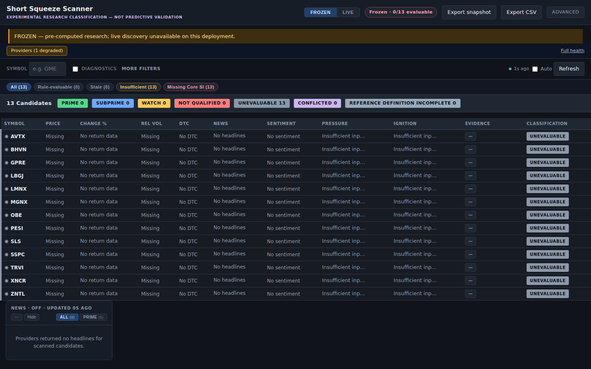
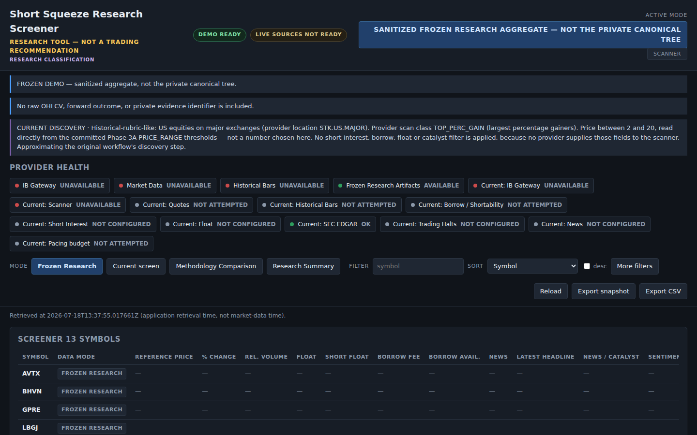
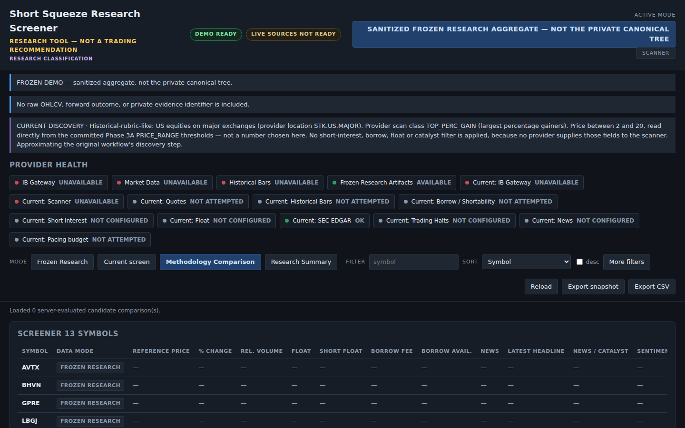
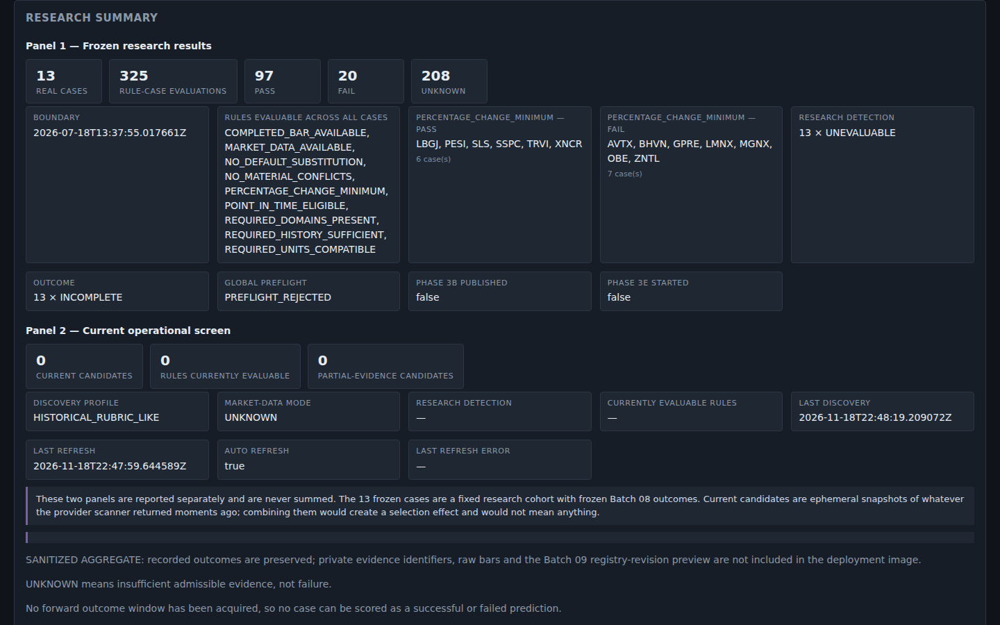
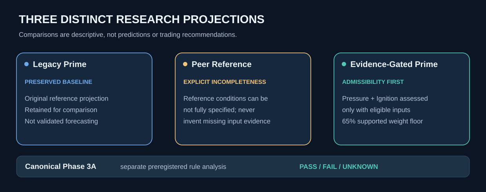
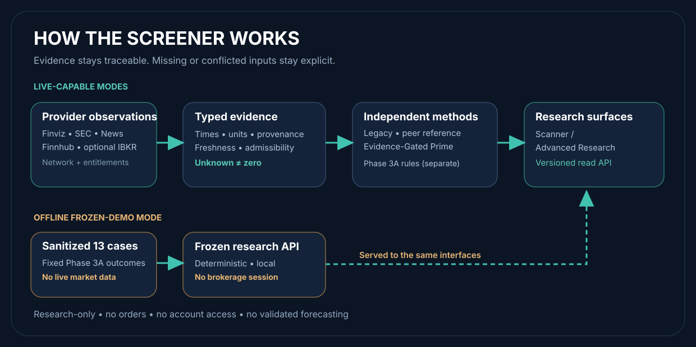

# Short Squeeze Research Screener

**See what the evidence supports, what it contradicts, and what remains unknown.**

Open-source, read-only research software for examining short-squeeze candidates. Includes a Scanner, an Advanced Research workspace, independent methodology comparisons, an API, and a deterministic offline demonstration.

[Quick start](#try-the-frozen-demo) · [Walkthrough](docs/portfolio/walkthrough.md) · [Methodologies](short-squeeze-core/docs/METHODOLOGIES.md) · [API](short-squeeze-core/docs/API.md)

    

> **Research only — not a trading recommendation.** No order placement, brokerage account access, price predictions or claims of validated short-squeeze forecasting. Frozen candidates are sanitized examples, not current market signals.

## The application

The images below are intended to be **actual browser captures** of the running FROZEN_DEMO build, generated by the [reproducible screenshot process](docs/portfolio/README.md), not recreated mockups.

| Scanner | Advanced Research |
| :--- | :--- |
|  |  |

**Important demo limitation:** the sanitized fixture does not contain the full market inputs needed for server-evaluated methodology comparisons. In FROZEN_DEMO, this tab correctly reports **0 comparable candidates**; it does not fabricate pressure/ignition values. The actual frozen rule outcomes are available in Research Summary:

[Watch the short frozen-demo walkthrough](docs/portfolio/assets/frozen-demo-walkthrough.webm) · [Follow the narrated steps](docs/portfolio/walkthrough.md)

## Why this project exists

Most dashboards show a ranking without explaining the quality of the underlying evidence. This research screener distinguishes available observations from missing, stale, conflicting or inadmissible information. It presents three independent methodology outputs rather than collapsing them into a confident-looking trading signal.

- **Scanner:** Filter research candidates by symbol, market data, pressure, ignition, evidence coverage, news and classification.
- **Advanced Research:** Examine case details and canonical Phase 3A rule outcomes. In current/live-capable modes with admissible inputs, compare methodologies; the sanitized demo deliberately cannot calculate those projections.
- **Evidence-Gated Prime v1:** Evaluates supported pressure and ignition inputs without replacing missing data with zero; the sanitized fixture is not sufficient to compute these scores.
- **Frozen demo:** 13 sanitized candidates with 25 rule outcomes each: **97 PASS, 20 FAIL, 208 UNKNOWN** across 325 rule/case evaluations. These are research-rule outcomes, **not** profitable-trade results.
- **Stable integration surface:** API version 1.0.0; schema batch14.integration.v1, documented in the [API reference](short-squeeze-core/docs/API.md).

## Try the frozen demo

Requires Python 3.12. After installing dependencies, frozen mode runs locally with **no provider credentials or live data connection**.

**macOS / Linux**

~~~bash
git clone https://github.com/AdamEddahmouni/short-squeeze-screener-internship.git
cd short-squeeze-screener-internship/short-squeeze-core
python3.12 -m venv .venv
source .venv/bin/activate
python -m pip install -e '.[test]'
export SQUEEZE_APP_MODE=FROZEN_DEMO
python -m apps.research_screener --no-browser
~~~

**Windows PowerShell** (from the same short-squeeze-core directory)

~~~powershell
py -3.12 -m venv .venv
.\.venv\Scripts\python.exe -m pip install -e ".[test]"
$env:SQUEEZE_APP_MODE = "FROZEN_DEMO"
.\.venv\Scripts\python.exe -m apps.research_screener --no-browser
~~~

Open [Scanner](http://127.0.0.1:8787/) or [Advanced Research](http://127.0.0.1:8787/advanced). See the complete [getting-started guide](short-squeeze-core/docs/getting-started.md) for setup and troubleshooting.

## Understand the methodologies

| Research projection | How it should be interpreted |
| --- | --- |
| Legacy Prime Setup | Preserved reference baseline; not validated prediction |
| Peer Reference | Can report REFERENCE_DEFINITION_INCOMPLETE instead of inventing missing reference inputs |
| Evidence-Gated Prime v1 | Evaluates pressure and ignition only with sufficient admissible evidence (65% supported weight per dimension by default) |
| Canonical Phase 3A | Independent preregistered rule outcomes; UNKNOWN is different from FAIL |

See [methodology definitions and calibration caveats](short-squeeze-core/docs/METHODOLOGIES.md).

## Architecture

Live-capable modes collect provider observations with freshness, timestamps, provenance and admissibility attached. The research rules and independent methodologies transform eligible evidence into descriptive classifications. Both browser views and the API read the resulting research records.

**Frozen demo is deliberately separate:** bundled sanitized records are served locally; the application does not contact IBKR or other live market providers in that mode.

## Verification and limitations

From the short-squeeze-core directory after installing dependencies:

~~~bash
python tools/integration_acceptance.py --mode frozen
python -m pytest -p no:cacheprovider --basetemp .pytest-run
~~~

The acceptance script checks frozen totals, methodology identifiers, API versions, both browser routes, export behavior and absence of account/order/trading endpoints.

**Predictive validation is incomplete.** The screener is not backtested as a forecasting product and does not report live execution performance or P&L. Read [limitations](short-squeeze-core/docs/LIMITATIONS.md) and [reproducibility](short-squeeze-core/docs/reproducibility.md) before relying on output.

[Architecture details](short-squeeze-core/docs/architecture.md) · [Provider requirements](short-squeeze-core/docs/PROVIDERS.md) · [Security](SECURITY.md) · [Contributing](CONTRIBUTING.md) · [MIT license](LICENSE)
