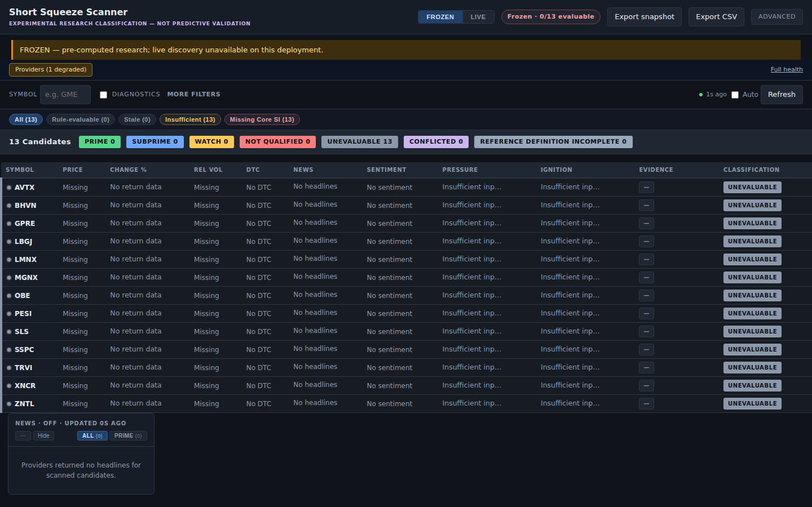
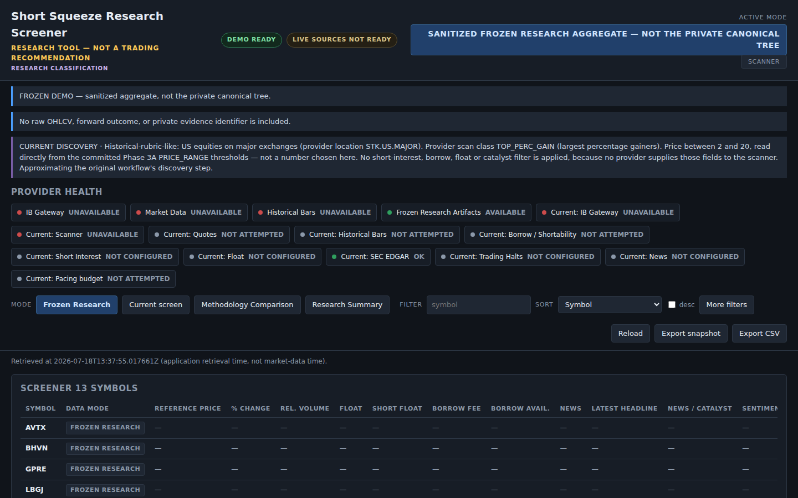
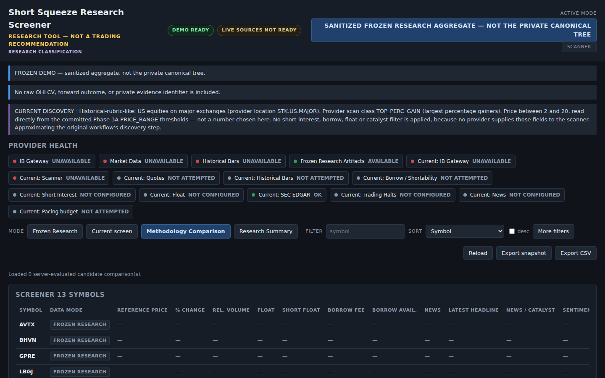
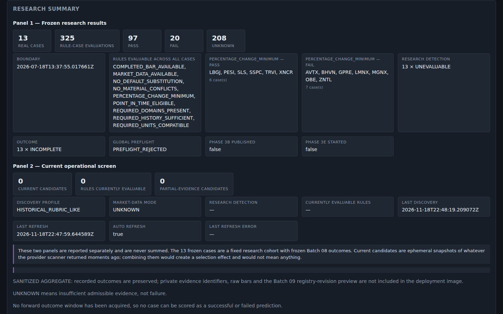

# Walkthrough: Explore the frozen research screener

This walkthrough uses only the bundled sanitized, deterministic dataset. It does **not** connect to providers, submit orders, or demonstrate predictive validation.

## Start

Follow the [quick start](../../README.md#try-the-frozen-demo) and set SQUEEZE_APP_MODE=FROZEN_DEMO. Open http://127.0.0.1:8787/.

### 1. Scan the available cases

- Check that the mode is **FROZEN**, not LIVE.
- View the research candidates in the Scanner table. The fixed demonstration contains 13 sanitized examples.
- Filter by symbol or open additional filters. A blank/missing field is **not** interpreted as zero.
- Select a case to inspect what evidence is present and which details remain unavailable.

### 2. Inspect Advanced Research

Select **Advanced** or navigate to http://127.0.0.1:8787/advanced.

- Start with the **Frozen Research** tab.
- Inspect the PASS, FAIL and UNKNOWN rule counts. Across 13 cases × 25 rules, the bundled aggregate is **97 PASS, 20 FAIL, 208 UNKNOWN**.
- Notice that these are research-rule outcomes, not records of a profitable trade or validated future price move.
- Use the case context and explicit missingness rather than assuming absent evidence means a negative result.

### 3. Compare research methods

- Click **Methodology Comparison**.
- The frozen demo deliberately shows **0 server-evaluated methodology comparisons** because full underlying market observations are not included in the sanitized fixture. Do **not** interpret this as a populated comparison or claim it demonstrates live scores.
- Use the documented Legacy Prime, Peer Reference and Evidence-Gated Prime definitions to understand what a fully evidenced comparison would require.
- Interpret the Pressure × Ignition landscape as a **descriptive research visualization** only; cases may be unplotted because necessary observations are absent.
- If a peer reference is incomplete or inputs conflict, the system reports that condition instead of manufacturing a classification.

### 4. Review the Research Summary

Select **Research Summary** to see the available sanitized aggregate counts and research constraints. This is the substantive part of the offline demonstration: inspect aggregate PASS / FAIL / UNKNOWN rule outcomes without claiming they measure trading performance.

### 5. Verify, then assess the limitations

For an automated, local verification, run from short-squeeze-core:

~~~bash
python tools/integration_acceptance.py --mode frozen
~~~

This checks the known 13-case fixture, versioned API, methodology IDs and both UI routes. It also checks that trading/account/order endpoints do not exist.

Review [methodology semantics](../../short-squeeze-core/docs/METHODOLOGIES.md) and [limitations](../../short-squeeze-core/docs/LIMITATIONS.md). The demo makes no predictive, brokerage or trading-performance claim.

**Short video:** [Real browser walkthrough](assets/frozen-demo-walkthrough.webm), when generated by the verified capture workflow.
